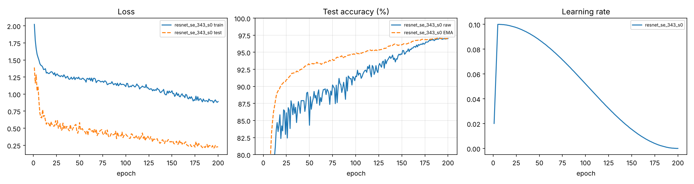

# CIFAR-10 ResNet under 5M parameters — Deep Learning Project 1 (Fall 2026)

**Team KHL** — Shreyas Kaldate, Adhyayan Verma, Sumit Shah  ·  **Report:** [`report/report.pdf`](report/report.pdf)

A modified ResNet with **4,988,274 trainable parameters** (budget: 5,000,000), trained from scratch on the
competition's 50k training images.

| | CIFAR-10 test (10k) | + flip TTA | Kaggle public | Kaggle private |
|---|---|---|---|---|
| `resnet_se_343`, seed 0 (final) | **97.00%** | **97.20%** | 0.891 (rank 49) | 0.869 (rank 41) |
| `resnet_se_343`, seed 1 | 96.88% | 97.08% | – | – |

Per-epoch log: [`checkpoints/resnet_se_343_s0/log.csv`](checkpoints/resnet_se_343_s0/log.csv) ·
executed notebook with printed parameter count and final accuracy:
[`notebooks/kaggle_run_resnet_se_343_s0_executed.ipynb`](notebooks/kaggle_run_resnet_se_343_s0_executed.ipynb) ·
trained weights (`best.pt`, EMA): see the GitHub **Release** of this repo.



## Final architecture: `resnet_se_343`

| Stage | Blocks | Channels | Spatial | Notes |
|---|---|---|---|---|
| stem | 1 conv 3×3 | 64 | 32×32 | conv-BN-ReLU |
| 1 | 3 BasicBlocks | 64 | 32×32 | SE attention in every block |
| 2 | 4 BasicBlocks | 128 | 16×16 | 3×3 projection shortcut on downsample |
| 3 | 3 BasicBlocks | 256 | 8×8 | 3×3 projection shortcut on downsample |
| head | AdaptiveAvgPool(1) → Dropout(0.1) → Linear(256→10) | | | |

Each BasicBlock implements `ReLU(S(x) + SE(F(x)))` with `F = conv3×3-BN-ReLU-conv3×3-BN`.

Design rationale: with a 5M budget, a fourth 512-channel stage spends ~2.4M params on 4×4 feature maps.
Removing it and spending the parameters on *depth* in the 64/128/256 stages (plus almost-free SE attention)
gives a better accuracy-per-parameter trade-off on 32×32 images. See the report for the ablation.

## Training recipe

| Component | Setting |
|---|---|
| Optimizer | SGD, momentum 0.9, Nesterov, lr 0.1 (batch 128), wd 5e-4 (not on BN/bias) |
| Schedule | 5 warm-up epochs → cosine to 0, 200 epochs |
| Loss | Cross-entropy, label smoothing 0.1 |
| Augmentation | RandomCrop(32, pad 4, reflect) · HFlip · TrivialAugmentWide · RandomErasing(p=0.25) |
| Batch mixing | CutMix (α=1) or MixUp (α=0.2), one of them with prob 0.5 per batch |
| Weights | EMA (decay 0.999) of weights is the evaluated/submitted model |
| Inference | 10-view TTA: {center, 4 × 2-px shifts} × {orig, h-flip}, softmax-averaged |
| Distillation | final student trained with `--teachers` = 3 independently trained models (averaged soft labels, T=4, α=0.9) |
| Precision | AMP fp16 + channels_last |

## Reproduce

```bash
pip install -r requirements.txt

# 0. put the competition data in data/:  train_labels.csv, train_images/, test.csv, test_images/

# 1. train on the competition images (≈2–3 h on one A100/RTX8000). The torchvision CIFAR-10
#    test split (never trained on) is downloaded automatically and used for reported accuracy.
python train.py --model resnet_se_343 --epochs 200 --train_csv data/train_labels.csv --out checkpoints/resnet_se_343_s0

# 2. plots
python plot_results.py checkpoints/resnet_se_343_s0 --out figures/curves.png

# 3. Kaggle submission 
python predict.py --ckpts checkpoints/resnet_se_343_s0/best.pt --test_csv data/test.csv --test_dir data/test_images --out submission.csv

# 4. (competition model) train 2 more seeds, then distill a single <5M student from the 3-model ensemble
python train.py --model resnet_se_343 --epochs 200 --seed 1 --train_csv data/train_labels.csv --out checkpoints/resnet_se_343_s1
python train.py --model resnet_se_343 --epochs 200 --seed 2 --train_csv data/train_labels.csv --out checkpoints/resnet_se_343_s2
python train.py --model resnet_se_343 --epochs 200 --seed 7 --train_csv data/train_labels.csv \
       --teachers checkpoints/resnet_se_343_s0/best.pt checkpoints/resnet_se_343_s1/best.pt checkpoints/resnet_se_343_s2/best.pt \
       --out checkpoints/student_kd
python predict.py --ckpts checkpoints/student_kd/best.pt --test_csv data/test.csv --test_dir data/test_images --out submission.csv

# NYU Greene:  MODEL=resnet_se_343 SEED=0 sbatch run_hpc.sbatch
```

### About the competition test set
The 2,000 Kaggle test images are not drawn from the CIFAR-10 test split: they are clean natural images with ~200 per
class and slightly different statistics, consistent with **CIFAR-10.1** (Recht et al., 2019), a re-collection of
CIFAR-10 from the same source designed to measure generalisation. Classifiers lose ~5-10 points on it, and the drop is
well described by a linear relationship with CIFAR-10 accuracy ("accuracy on the line", Miller et al., 2021), so our
strategy is to maximise genuine CIFAR-10 accuracy (strong regularisation, long schedules, EMA, distillation, TTA)
rather than to engineer for a specific corruption. We report both the 10k CIFAR-10 test accuracy and the Kaggle score.

`train.py` prints **the number of trainable parameters** at start and **the final test accuracy** at the end,
and writes `log.csv` (per-epoch metrics), `config.json`, `best.pt`, `last.pt`, and `final.json`.

`notebooks/train_and_eval.ipynb` walks through the same pipeline with plots (curves, confusion matrix,
ablation table) and the parameter-count / accuracy print-outs the graders ask for.

## Repository layout

```
models/resnet.py    configurable ResNet (C_i, N_i, F_i, K_i, P, SE, dropout) + named configs + param counter
data.py             CIFAR-10 loaders with augmentation; Kaggle test-pickle dataset
train.py            training loop: SGD/cosine, label smoothing, CutMix/MixUp, EMA, AMP, checkpointing, logging
predict.py          submission.csv generation with flip-TTA (and optional checkpoint ensembling)
plot_results.py     training-curve figures from log.csv
run_hpc.sbatch      SLURM script for NYU Greene
notebooks/          train_and_eval.ipynb
checkpoints/        one folder per run (log.csv, config.json, final.json, *.pt)
```

## Rules compliance
* Trained from scratch — no pre-trained weights, no external datasets.
* Parameter count asserted `≤ 5,000,000` at the start of every run (`train.py`) and printed in the notebook.

## Citations
* K. He, X. Zhang, S. Ren, J. Sun. *Deep Residual Learning for Image Recognition.* CVPR 2016.
* J. Hu, L. Shen, G. Sun. *Squeeze-and-Excitation Networks.* CVPR 2018.
* S. Yun et al. *CutMix.* ICCV 2019.  ·  H. Zhang et al. *mixup.* ICLR 2018.
* S. Müller, F. Hutter. *TrivialAugment.* ICCV 2021.
* Z. Zhong et al. *Random Erasing Data Augmentation.* AAAI 2020.
* C. Szegedy et al. *Rethinking the Inception Architecture* (label smoothing). CVPR 2016.
* I. Loshchilov, F. Hutter. *SGDR: Stochastic Gradient Descent with Warm Restarts* (cosine schedule). ICLR 2017.
* G. Hinton, O. Vinyals, J. Dean. *Distilling the Knowledge in a Neural Network.* 2015.
* B. Recht, R. Roelofs, L. Schmidt, V. Shankar. *Do ImageNet Classifiers Generalize to ImageNet?* ICML 2019 (CIFAR-10.1).
* J. Miller et al. *Accuracy on the Line: On the Strong Correlation Between OOD and ID Generalization.* ICML 2021.
* Code structure of the ResNet BasicBlock adapted from `kuangliu/pytorch-cifar` (MIT License).
